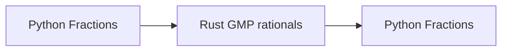

# 0001: Rust ownership of profile storage

## Context

As profiles pass between generators, transformations, and elections, their numeric representation
must remain valid without repeated conversion or dependence on mutable caller input. The common
`RankMatrix` and `ScoreMatrix` interfaces provide the boundary at which to establish that
ownership.

## Decision

Rust owns the authoritative numeric storage behind the Python matrix interfaces: candidate-set
IDs, numeric membership, and weights for ranked matrices, and score values, column mappings, and
weights for scored matrices. Where Python retains labels, frozen voter sets, or provenance,
construction establishes their alignment with the matrix rows.

Public constructors validate and copy caller-owned buffers so subsequent edits cannot alter the
profile. Once ownership is established, internal constructors can move or share validated Rust
allocations, checking only the fields affected by a transformation. Copies and transformations
therefore share unchanged immutable storage. Cached results may also be shared when their inputs
remain unchanged. For example, `ScoreMatrix._declared_score_columns` is an eagerly computed lookup
that depends on candidate and column order. Replacing weights can preserve that lookup but must
invalidate any cached total weight or positive-weight candidate membership.

Elections share immutable profile storage but own their changing weights, cursors, candidate
activity, row order, and transitions. Independent counts cannot alter one another's state.

DataFrame conversion remains with the Python adapters. This allows the protocol to include
`from_df` and `to_df` while the Rust interface operates on numeric values. Encoding may invoke
Python normalization while attached to the interpreter; after the values enter Rust ownership,
computation may detach.

Public NumPy exports return independent copies. A shared-view API is deferred until it can
guarantee both the allocation's lifetime and the absence of writable aliases.

## Considered Alternatives

Borrowing Python-owned NumPy arrays would support individual Rust operations with little binding
overhead. It would, however, leave generators and exact arithmetic to reconcile Python-owned
storage with their Rust results. This is particularly important for avoiding the round-trip

Rust ownership gives these operations a common representation.

Caching a Rust-owned copy beside a Python matrix would amortize conversion across repeated calls
but retain both representations for the profile's lifetime.

## Consequences

Rust generators and transformations can return profiles without exporting and reimporting their
numeric buffers. Repeated elections reuse the same immutable input while retaining independent
workspaces.

Because `.rankings` and `.weights` become copying exports, computational consumers must move to
matrix operations to avoid repeated full-buffer allocations. Compatibility exports remain
available during the migration, with hot paths moved behind the interface.

Ownership verification concerns value preservation, isolation, lifetime, and shared Rust
allocations rather than Python array identity. The
[storage plan](../design-blueprints/rust-core-migration/stage-2-array-storage.md) and
[Rust integration plan](../design-blueprints/rust-core-migration/stage-5-rust-execution.md)
specify construction, persistence, and binding requirements.
