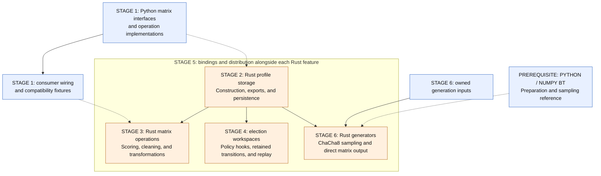

# Preference profiles, elections, and generators: Rust core migration

This migration places profile storage and numerical computation in Rust behind VoteKit's Python
interfaces. `ProfileMatrix` defines the boundary: Python interprets labeled inputs and constructs
public representations while Rust owns the numeric values and the operations on them. Elections
retain mutable workspaces separate from immutable profiles. Generators prepare sampling tables and
return profiles through the same interface.

[The migration ADRs](../../README.md#accepted-matrix-migration-decisions) record the architectural
decisions. This blueprint outlines a way to realize them, bringing the proposed design together
with its dependencies, compatibility concerns, and unresolved questions.

The numbered stages organize the discussion rather than prescribe a fixed delivery sequence.
Implementers can reorder or combine work, revise the interface sketches, and carry a small
operation through Python, Rust, and the bindings before expanding it. Use those results to refine
the outline. Ownership, arithmetic, and public behavior still need deliberate treatment; if a
better approach changes an architectural decision, revisit the corresponding ADR and explain the
tradeoff.

## Architectural map

| Document                                     | Responsibility                                            |
| -------------------------------------------- | --------------------------------------------------------- |
| [Engineering notes](engineering-notes.md)    | Constraints shared across implementations                 |
| [Stage 1](stage-1-python-matrices/README.md) | Python matrix operations, consumer wiring, and fixtures   |
| [Stage 2](stage-2-array-storage.md)          | Matrix ownership, construction, exports, and persistence  |
| [Stage 3](stage-3-profile-operations.md)     | Rust implementations of matrix computation                |
| [Stage 4](stage-4-election-state.md)         | Election workspaces, policy hooks, and replay             |
| [Stage 5](stage-5-rust-execution.md)         | Rust integration and distribution                         |
| [Stage 6](stage-6-native-generators.md)      | Configuration capture, direct generation, and BT sampling |

The stages divide responsibilities without requiring a serial rewrite: Python consumer ports and
generator algorithms can proceed independently of Rust storage. Packaging, however, must be ready
before any Rust path becomes the production default.

## Ownership and execution

| Owner                         | State                                                              | Responsibility                          |
| ----------------------------- | ------------------------------------------------------------------ | --------------------------------------- |
| Rust matrix                   | Ranking IDs or scores, membership or column mapping, typed weights | Immutable values and matrix operations  |
| Python facade                 | Labels, adapters, voters, provenance                               | Public construction and materialization |
| Election workspace            | Changing weights, cursors, activity, row order, transitions        | Counting and replay                     |
| Private generator preparation | Captured parameters and completion tables                          | Sampling                                |

Public construction establishes ownership by validating and copying external input. Subsequent
operations can then transfer new Rust-owned allocations or share unchanged immutable storage,
allowing elections to reuse fixed rankings and initial weights while keeping mutable state private
to each count. Rust generators enter the same ownership model directly, returning profiles whose
matrices own their sampled buffers.

Rankings continue to encode candidate sets. A singleton election checks its narrower preconditions
and decodes through a set-to-candidate lookup as it traverses the shared matrix. Candidate-set
IDs, candidate indices, physical rows, and public labels remain distinct. Traversal uses the
shared ranking matrix rather than maintaining a second decoded copy.

Weights use float64 or GMP-backed rationals. Score storage in Rust uses float64, accepting other
numeric inputs only through value-preserving conversion. Scores admit positive infinity and use
NaN for missing values; weights remain finite and nonnegative.

The Python protocol retains DataFrame adapters, but complete numerical operations stay behind the
binding. Copying array exports support consumers awaiting migration; Rust operations access their
owned storage directly.

Rust controls supported election counts and built-in policy, invoking Python hooks for custom
behavior and retaining their effects with the executed transitions. Those records support replay
without further callback invocation and keep reconstructed profiles aligned with immutable round
summaries. Custom algorithms outside this runner retain Python execution and its existing
reconstruction limitations.

Generators keep explicit one-off functions. Preparation remains private, and Python draws seeds
for Rust ChaCha8 RNGs. Name BT samples positive-support candidates and appends zero-support
candidates under a tiebreak rule. A public prepared-sampler object, shared NumPy views, and a
common Rust history owner are deferred.

## Compatibility decisions

The accepted Python matrix implementation is the behavioral reference for the port. Compatibility
fixtures distinguish intentional changes from regressions and retain historical payloads needed
for persistence support.

The Python matrix work has already introduced dense set IDs, float64/Fraction weight variants, the
`2**50` total cap, nonnegative scores, first-appearance grouping, and fresh DataFrame exports. The
Rust migration adds float64-only score storage with lossless input conversion, scalar Neumaier
summation for total float weight, float mentions, and grouped float weights, immutable election
history, and the specified generator tail and seed contracts. Under
[ADR 0005](../../ADRs/0005-profile-numeric-contracts.md), Neumaier replaces `math.fsum` for totals
and mentions and weighted `np.bincount` for grouping. SIMD summation is outside this implementation.
`.df` is deprecated as of 3.6.0 and scheduled for removal in the next major release.

Compatibility includes extension hooks, provenance, and election decisions under the documented
arithmetic. Generator samples are reproducible within a fixed version but may change between minor
versions. Election tiebreak and RNG behavior retain their separate contracts. Unsupported Rust
configurations are dispatched to compatible execution before counting; failures after Rust
execution begins propagate without retry.

FastSTV remains unchanged, with deprecation planned for 4.0. Municipal RuleSets are outside this
migration. Pandas remains an input/export dependency, and Numba remains while supported consumers
require it.

## A possible route through the work

What follows is a suggested outline, but is not meant to be authoritative:

1. Complete Python matrix operations and wire their consumers through those interfaces, preserving
   extensions and filling compatibility-test gaps. Stage 1 introduces no Rust code.
2. Implement Rust rank and score owners and connect the Python facades. Port matrix computations
   behind the same interfaces, preserving Python labels, diagnostics, and provenance.
3. Integrate the Rust election runner, immutable public history, custom Python hooks, and replay.
4. Establish owned configuration inputs and direct matrix generation. Port the assumed
   Python/NumPy BT implementation to Rust and compare it with that reference. Generator work can
   proceed independently of election integration.

Stage 5 accompanies the other work with the extension, bindings, and distribution needed to
connect Rust to Python. The individual stages identify both sides of that work so profile families
and operations can migrate independently while preserving one numeric owner per profile.

## Stage and feature dependencies

The arrows describe dependencies for a selected feature, not completion of an entire stage. Solid
arrows show required capabilities; dashed arrows show Python interface or reference work that
informs the Rust implementation. Stage 5 accompanies each Rust feature with its bindings and
distribution.

Election and generator integration need the relevant profile storage, but neither requires all
stage 3 computations to have been ported. Generator work is independent of the election runner.
Python consumer ports, configuration capture, and sampling preparation can proceed while Rust
storage is being developed. Each Rust feature can be integrated and shipped when its own
dependencies and public contracts are satisfied.
