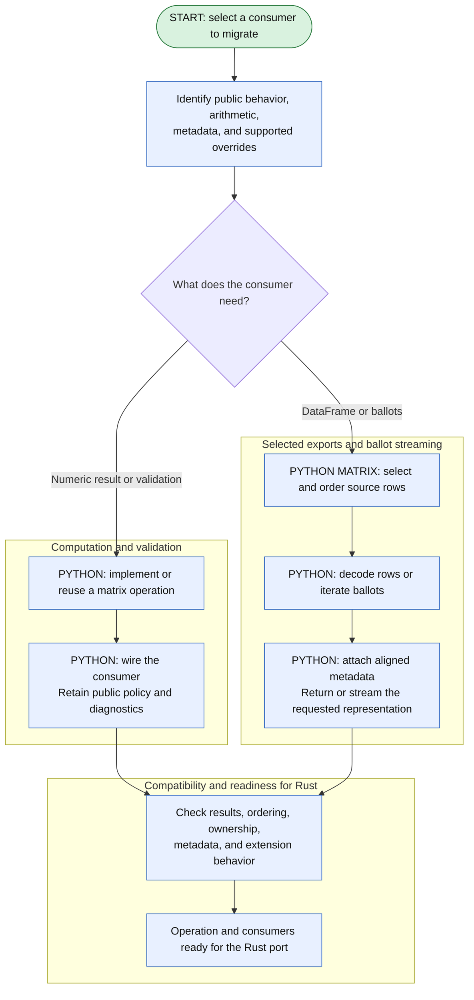

# Stage 1: finish Python matrix operations and consumer wiring

## Goal

Complete the Python matrix boundary so internal consumers request operations instead of
interpreting DataFrames, materializing whole ballot tuples, or decoding raw matrix storage
themselves. The matrix classes own numerical computation and storage semantics; their callers
retain public policy, labels, diagnostics, and extension behavior.

Stage 2 replaces storage behind these interfaces, and stage 3 ports their computations to Rust.
Finish the Python path and its compatibility cases for each operation before replacing it. Work
can proceed through those stages one operation at a time without waiting for every consumer to
migrate.

## Rust work

This stage introduces no Rust implementation. Its Python/NumPy operations provide the executable
reference and interfaces needed by the storage and computation ports.

## Python work

Complete the wiring throughout the package, including consumers that already use `_matrix` but
still interpret ranking IDs, candidate-set offsets, score columns, or weight arrays outside the
matrix modules. Replacing `.df` with a raw array export alone does not establish the intended
boundary: that export would become a copy when Rust owns storage.

Reuse existing structural queries, row decoding, grouping, concatenation, and weight replacement.
Extend concrete matrix interfaces where a consumer needs another operation. Put public validation
policy and result formatting in the existing wrappers, with storage interpretation in the matrix
implementation. Shared operations belong on the protocol only when both matrix families support
the same contract.

Intentional materialization remains appropriate. A DataFrame constructor accepts a DataFrame;
`to_df()` returns one; ballot dictionaries contain ballot objects; and custom callbacks may
require ballots. The task is to eliminate unnecessary intermediates and materialize only the
requested data. FastSTV and `NumpySTVBase` remain outside the migration.

## Feature flow

Each consumer group can migrate independently. The two branches separate internal computation from
intentional public materialization, then converge on compatibility checks for the selected
operation. The [master diagram](../master.md#stage-and-feature-dependencies) shows how these
Python interfaces support the Rust ports.

## Consumer checklist

The checklist names operations and source files rather than prescribing a commit sequence. Some
paths already use matrices; verify and reuse them instead of implementing them again. Check an
item off when its callers use the intended boundary and the relevant behavior is covered. File
links are relative to the repository, and test locations identify existing suites to extend where
needed.

Checklist labels identify where the work belongs:

- **Matrix:** implement or revise behavior in `profile_matrix/`, including its shared-data
  component or protocol. A source link to a consumer does not make that consumer the
  implementation owner.
- **Callers:** use matrix operations from profile facades, utilities, cleaning, elections, or
  other consumers. Reuse an existing operation when its contract matches.
- **Matrix + callers:** introduce or move the operation into the matrix module, then wire the
  named consumers through it. These are two parts of the same migration, not interchangeable
  tasks.
- **Verify:** preserve or test behavior that already exists; the item does not by itself call for
  another implementation.

### Implementation guides

Each guide corresponds to one category in the implementation dependency diagram. It keeps that
category's checklist, implementation layout, and caller inventory together. These are work areas,
not sequential milestones; choose an operation and follow its dependencies across guides as
needed.

| Diagram category and guide                                                                      | Scope                                                                                              |
| ----------------------------------------------------------------------------------------------- | -------------------------------------------------------------------------------------------------- |
| [Matrix interfaces and shared data](matrix-interfaces-and-shared-data.md)                       | Structural queries, scalar and bulk access, column order, metadata, and protocol responsibilities. |
| [Profile facades and metadata](profile-facades-and-metadata.md)                                 | Profile methods, equality, result construction, and metadata access.                               |
| [Ranked cleaning](ranked-profile-cleaning.md)                                                   | Candidate removal, condensation, repeated candidates, row filtering, and callbacks.                |
| [Score cleaning](score-profile-cleaning.md)                                                     | Score erasure, column selection, row filtering, and callbacks.                                     |
| [Scoring, mentions, and profile transformations](scoring-and-profile-transformations.md)        | Reductions, first-candidate partitions, rank-to-score conversion, completion, and tie expansion.   |
| [Election validation and Python counting](election-validation-and-counting.md)                  | Validation, transfers, veto consumers, and ordinary STV wiring.                                    |
| [Pairwise, candidate matrices, distances, and representation](pairwise-matrices-and-metrics.md) | Pairwise input encoding, candidate measures, grouped distributions, and representation.            |
| [Search, display, dictionaries, graphs, and CSV](search-and-profile-exports.md)                 | Selected-row exports, stable ordering, row decoding, and ballot streaming.                         |
| [Input adapters and producer output paths](input-adapters-and-generators.md)                    | Loader and generator integration, including the boundary with stage 6.                             |

### Implementation dependencies

Organize implementation chunks by the consumer categories below. Within each category, the arrows
run from the matrix capability to its callers. Between categories, arrows show only the main
shared dependencies. Existing methods can satisfy those dependencies; a category does not have to
finish before another can use one of its operations.

```mermaid
flowchart TB
    subgraph FOUNDATION["Matrix interfaces and shared data"]
        direction LR
        ACCESS["Queries, row access,<br/>and metadata contracts"]
        RESULTS["Selection and result construction<br/>with row correspondence"]
        ACCESS --> RESULTS
    end

    subgraph PROFILES["Profile facades and metadata"]
        direction LR
        FACADE["Wire matrix operations<br/>into profile methods"]
        PROFILE_OPS["Copy, group, add, replace weights<br/>Preserve metadata and result types"]
        FACADE --> PROFILE_OPS
    end

    subgraph RANK_CLEANING["Ranked cleaning"]
        direction LR
        RANK_OPS["Set remapping, condensation,<br/>repeat removal, and row filtering"]
        RANK_CALLERS["Publish cleaned profiles<br/>with provenance"]
        RANK_CALLBACKS["Stream callback inputs<br/>Validate and assemble results"]
        RANK_OPS --> RANK_CALLERS
        RANK_CALLBACKS --> RANK_CALLERS
    end

    subgraph SCORE_CLEANING["Score cleaning"]
        direction LR
        SCORE_OPS["Column selection<br/>and row filtering"]
        SCORE_CALLERS["Publish cleaned profiles<br/>with provenance"]
        SCORE_CALLBACKS["Stream callback inputs<br/>Validate and assemble results"]
        SCORE_OPS --> SCORE_CALLERS
        SCORE_CALLBACKS --> SCORE_CALLERS
    end

    subgraph SCORING["Scoring, mentions, and profile transformations"]
        direction LR
        REDUCE["Matrix reductions<br/>and first-candidate partitions"]
        SCORE_UTILS["Wire float and exact scoring,<br/>mentions, and ballot lengths"]
        TRANSFORM["Rank-to-score, completion,<br/>and tie expansion"]
        REDUCE --> SCORE_UTILS
    end

    subgraph ELECTIONS["Election validation and Python counting"]
        direction LR
        VALIDATE["Structural and score queries<br/>Diagnostic ballots only"]
        COUNT["Wire veto and ordinary STV<br/>through shared operations"]
        TRANSFERS["Remove transfer round trips<br/>Preserve custom callbacks"]
        VALIDATE --> COUNT
        TRANSFERS --> COUNT
    end

    subgraph METRICS["Pairwise, candidate matrices, distances, and representation"]
        direction LR
        ENCODE["Matrix queries<br/>and pairwise input adapter"]
        MEASURES["Pairwise, candidate matrices,<br/>and representation scores"]
        GROUPED["Grouped matrix distributions"]
        DISTANCE["Distance functions and MDS"]
        ENCODE --> MEASURES
        GROUPED --> DISTANCE
    end

    subgraph EXPORTS["Search, display, dictionaries, graphs, and CSV"]
        direction LR
        SELECT["Select and order rows"]
        DISPLAY["Search and head/tail exports"]
        ITERATE["Decode rows or iterate ballots"]
        STREAM["CSV, dictionaries,<br/>and ballot graphs"]
        SELECT --> DISPLAY
        ITERATE --> STREAM
    end

    subgraph PRODUCERS["Input adapters and producer output paths"]
        direction LR
        ASSEMBLY["Reuse grouping, addition,<br/>and profile utilities"]
        LOADERS["Wire loaders and existing<br/>generator output assembly"]
        ASSEMBLY --> LOADERS
    end

    FOUNDATION --> PROFILES
    PROFILES -->|Grouped rows| METRICS
    PROFILES -->|Profile assembly| PRODUCERS
    RANK_CLEANING -->|Removal and condensation| ELECTIONS
    SCORING -->|Scoring and partitions| ELECTIONS

    classDef capability fill:#e8f0ff,stroke:#356ac3,color:#111;
    classDef consumer fill:#d9f2df,stroke:#26783b,color:#111;
    class ACCESS,RESULTS,FACADE,RANK_OPS,RANK_CALLBACKS,SCORE_OPS,SCORE_CALLBACKS,REDUCE,TRANSFORM,VALIDATE,TRANSFERS,ENCODE,GROUPED,SELECT,ITERATE,ASSEMBLY capability;
    class PROFILE_OPS,RANK_CALLERS,SCORE_CALLERS,SCORE_UTILS,COUNT,MEASURES,DISTANCE,DISPLAY,STREAM,LOADERS consumer;
```

All categories use the shared matrix interfaces. The remaining cross-category dependencies are
narrow: distance distributions need grouping, producer assembly needs profile operations, and
ordinary STV uses ranked cleaning and scoring. Score cleaning and public exports can proceed
independently of those branches.

Treat each internal branch as a possible implementation chunk. Ranked candidate removal need not
wait for callback cleaning; CSV export need not wait for search. The cleaning branches converge on
the same provenance contract, not on a requirement to merge them together. Split ranked and scored
implementations when they can be reviewed independently.

Start with an operation that has a concrete caller and include only its missing matrix support.
Then follow that category's flow into the consumer. Ordinary STV can adopt individual helpers as
they land. Check indirect consumers with the helper they use: equality with grouping, plots with
scoring, and MDS with distances. Keep FastSTV untouched; Rust workspaces and generator ports
remain in later stages.

Use the source and test links in each guide to scope its implementation chunks. Apply the
[completion checklist](#compatibility-and-completion-checks) throughout, then finish with a
package-wide search for overlooked consumers. Ownership, metadata, arithmetic, and extension
checks belong in the affected implementation chunk rather than a final testing pass.

## Compatibility and completion checks

- [ ] **Verify:** Recheck `.df`, `._df`, `.to_df()`, `.ballots`, `.to_matrix()`, and direct
      numeric-array/table access throughout `src/votekit`. Trace aliases and helper calls as well
      as literal matches. Every remaining access should have an intentional boundary role or the
      FastSTV exclusion.
- [ ] **Verify:** Exercise rewritten numeric paths with profile export and complete-ballot
      materialization disabled after fixture construction. Keep callback, diagnostics, and
      explicit-export tests separate so legitimate materialization remains covered.
- [ ] **Verify:** Cover empty profiles, zero-weight rows, explicit empty positions, trailing
      padding, ties, repeated candidates, mixed string/integer labels, and declared but uncast
      candidates.
- [ ] **Verify:** Cover float and Fraction weights, score zeros/NaNs/infinities, candidate/column
      order, and operation-specific conversion and rounding. Keep the selected Rust Neumaier
      change distinct from Python wiring so unrelated reductions do not change accidentally.
- [ ] **Verify:** Compare row order, labels, voter sets, candidate metadata, cleaned parent
      chains, and category overlaps directly. Profile equality groups ballots and cannot establish
      those properties.
- [ ] **Verify:** Exercise custom profile accessors, callback invocation order and failures,
      election overrides, and RNG state where rewiring changes traversal or materialization.
- [ ] **Verify:** Capture representative pickle payloads for stage 2 before changing storage or
      serialization. Preserve public imports and distinguish intended compatibility changes from
      regressions.
- [ ] **Verify:** Run the affected existing suites and resolve gaps in those suites. Update
      documentation and private names that still describe a DataFrame route after their
      implementations have moved.

### Verification responsibilities

Extend matrix tests for the operation itself: encoding, numerical results, row correspondence, and
ownership. Extend the linked consumer suites for public policy, diagnostics, metadata, callbacks,
and result types. Producer tests check that grouping and addition retain generator semantics
without requiring new sampler implementations.

For each migrated path, disable the specific export or cached ballot property it should no longer
use after constructing the fixture. Do not disable `get_ballot()` or iteration indiscriminately:
diagnostics, ballot-valued outputs, and callbacks may intentionally need them. Check metadata
directly rather than relying on profile equality to detect lost labels or changed row order.

## Intended outcome

Internal profile consumers use complete matrix operations or intentionally request selected public
representations. The Python implementations and compatibility cases give the Rust port a reference
without making every consumer depend on Rust's storage layout. Stage 3 can then replace
computation behind that boundary rather than repeat the consumer rewiring.
