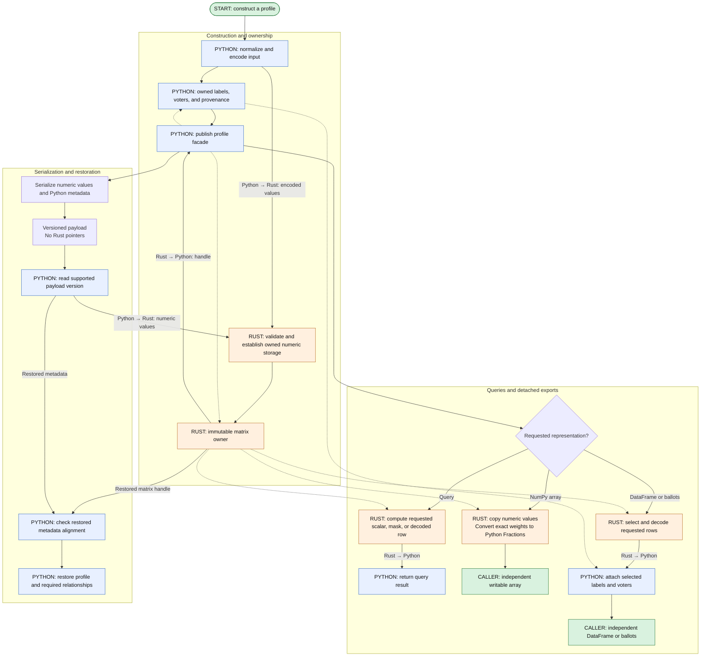

# Stage 2: authoritative profile matrices

## Goal

Replace numeric storage behind the existing `RankMatrix` and `ScoreMatrix` interfaces with
Rust-owned buffers. Each profile keeps one authoritative numeric owner, and Python continues to
provide labeled construction, metadata, and public materialization.

Ranked and scored profiles can migrate independently. Each migration covers construction,
transformations, exports, persistence, and affected readers so that ordinary operations do not
require a second Python matrix. [ADR 0001](../../ADRs/0001-profile-array-ownership.md) defines
ownership, [ADR 0004](../../ADRs/0004-matrix-representation-and-operations.md) defines
representation, and [ADR 0006](../../ADRs/0006-profile-exports-and-provenance.md) defines exports
and provenance.

## Feature flow

Construction establishes the owner used by queries, exports, and persistence. Each feature
occupies one subgraph; public construction and restoration converge on checked Rust storage. Solid
arrows show execution or returned data, and dashed arrows show retained references.

## Rust work

Implement immutable rank and score owners for candidate-set membership, score-column mapping,
float64 weights, and GMP rationals. These owners also perform structural queries, row decoding,
and checked construction, allowing Rust results to share immutable allocations and serialized
values to be restored into validated storage.

## Python work

Keep public constructors, DataFrame adapters, candidate labels, voter metadata, and provenance in
Python. Replace the numeric fields behind `RankMatrix` and `ScoreMatrix` with Rust owners and
route their methods through the binding. Update exports and persistence adapters to preserve
public values and relationships. Ranked and scored facades may migrate independently; stage 3
ports the matrix computations behind the consumer interfaces established in stage 1.

## Public and internal construction

Preserve `PreferenceProfile` dispatch to ranked or scored profiles, including empty construction
and mixed-ballot rejection. Python adapters own candidate-name normalization and DataFrame schema
interpretation. The matrix owns validated numeric structure and aligned shared data. Fused Rust
encoding may normalize distinct sets while attached, avoiding a normalized full-frame
intermediate.

Public array construction validates and copies caller data, establishing the ownership on which
internal construction relies. A validated matrix can then be wrapped without re-parsing DataFrames
or ballots, as the current `_from_matrix` methods do when establishing metadata and freezing the
profile. The Rust equivalent may transfer or share immutable buffers while still checking changed
weights, candidate membership, and alignment.

Generators may use trusted internal construction. A public constructor from dense singleton IDs is
optional; if introduced, it must distinguish candidate IDs from ranking-set IDs and specify
padding and duplicate handling without narrowing the general matrix contract.

### Construction flow

Stage 1 supplies the Python interface and input conventions. Construction establishes the Rust
owner before the facade publishes it; the original caller cannot mutate the stored values.

## Representation

Ranked storage contains a two-dimensional candidate-set ID array, a dense unique membership table,
typed weights, and aligned metadata. Reserved IDs are -2 for empty and -1 for end-of-ranking;
ordinary IDs start at zero. End sentinels trail. Membership uses internal candidate IDs while
Python preserves string/integer labels, declared order, and zero-weight-only undeclared labels.

Scored storage contains a float64 matrix and its score-column mapping. Public input of another
numeric dtype is accepted when conversion preserves its values and rejected otherwise. Check
representability before narrowing; a rounded result cannot establish that its source was exact.
The direct Python matrix currently retains supplied floating dtypes, so document this deliberate
storage and acceptance change. Negative values are invalid, signed zeros are canonicalized, and
NaN means missing. Explicit zeros and positive infinity remain supported. NaN payload bits and
original pandas column dtypes are not preserved. This score conversion policy does not widen
weight acceptance.

Weight variants and conversion rules follow
[ADR 0005](../../ADRs/0005-profile-numeric-contracts.md). GMP-backed exact storage retains
arbitrary-size rationals; Python Fraction arrays become exports or compatibility inputs rather
than a second authoritative exact vector.

Rust total-weight queries and validation use scalar Neumaier summation for float64 weights and
rational summation for exact weights. Share the float accumulator with the mentions operation in
stage 3. Python callers obtain the total through the matrix interface rather than exporting
weights to repeat the reduction.

Retain width, ranking-column labels, score-column order, declared candidates, voters, and source
row labels required by the current matrix contract. Round trips preserve ballot meaning rather
than every original DataFrame dtype, index metadata attribute, or historical code assignment.
Nondefault labels are independent of physical positions, including duplicate and noninteger
labels.

## Operations and exports

Preserve the common protocol and concrete ranked/scored operations. Queries such as
`has_rankings`, `has_ranked_candidates`, `has_ties`, score bounds, and totals should run against
Rust storage and return only their requested results. Operations must not depend on exporting
entire matrices first.

`to_df()` returns a fresh detached export; `.df` is its deprecated alias. Matrix row selection is
applied before decoding, preserving selected source labels and order. `get_ballot` and
`iter_ballots` materialize requested ballots directly. Full `.ballots` materialization remains
available for callers that request it. Built-in computation reads the matrix, so neither a cached
ballot tuple nor a cached `_df` is needed as an internal representation.

Public array exports copy, including the independent-copy contract of `to_matrix`. Internal
operations may share immutable allocations. Shared public views remain deferred pending a lifetime
and aliasing contract.

Each transformation preserves its existing contract: copying and weight replacement share
unchanged storage, grouping retains first-appearance order and weight/voter semantics, and
addition reconciles set tables or score columns. Alongside the numeric result, Rust operations
return the row correspondence Python needs to restore metadata.

### Query and export flow

Queries use the Rust owner directly. Public array exports receive independent writable storage;
DataFrames and ballots combine selected numeric values with the corresponding Python metadata.

## Provenance and subclass behavior

Keep cleaned parents, altered-index categories, and row-label mapping outside mutable exports.
Because filtering, grouping, and concatenation transform these relationships differently, each
operation must publish its metadata with the numeric result and preserve any category overlaps
permitted by cleaning semantics.

Audit supported profile overrides before switching a consumer. An extension may require a
compatible Python path even when the built-in type can execute natively. Detached exports remain
independent of the authoritative profile on either path.

## Module ownership

Use `pref_profile/profile_matrix/` for matrix behavior and `pref_profile/pref_profile/` for public
profile construction and materialization. Keep shared weight/voter/index handling with its current
owner. The common protocol specifies Python-facing behavior; Rust traits can describe the narrower
numerical operations without pandas dependencies.

Wire Rust construction through these modules, with internal dispatch and concrete ranked/scored
operations. Production integration does not use process-global monkey patches or a public backend
registry.

## Persistence transition

Add explicit versioned state containing authoritative values and provenance, not handles to Rust
objects, workspace caches, or public snapshots. Read baseline and new formats; old releases need
not read new formats. Capture baseline pickle fixtures before changing the implementation.

For old encoded-frame payloads, recover code meanings and weights from the authoritative fields.
Cleaned labels and parents require their own restoration path; do not infer them from a historical
internal RangeIndex. Ignore derived caches when authoritative data is present. Reject inconsistent
shapes or missing code meanings rather than guessing a repaired ballot from conflicting caches.

Use checked restoration before freezing or publishing the result. Test cached/uncached baseline
objects, cleaned parent chains, new Rust values, and copy/deepcopy relationships. Pickle remains
restricted to trusted input.

### Persistence flow

Serialization records values and metadata rather than Rust pointers. Restoration validates the
numeric payload and its metadata alignment before publishing a profile.

## Suggested implementation steps

1. Document existing matrix semantics and identify remaining direct-array consumers and exports.
2. Introduce Rust ranked ownership with adapters, structural queries, sharing, and persistence.
3. Introduce Rust scored ownership with equivalent column/missing-value and metadata behavior.
4. Port transformations and remove repeated Rust-to-NumPy-to-Rust conversion paths.

The profile families may activate in either order. A migrated family must own its values once;
unmigrated families can continue using Python matrices. Stage 1 covers Python consumer wiring,
stage 3 covers Rust computation ports, and stage 5 provides packaging.

## Verification

Test input mutation, export mutation, Rust ownership lifetime, independent elections, and shared
immutable copies. Verify values and metadata rather than Python array object identity. Include
empty dimensions, zero-weight rows, ties, repeats, mixed labels, NaN/zero/infinite scores, and
Fraction weights. Cover lossless score conversion and rejected narrowing, including finite values
that would overflow or underflow in float64. Reuse current validation for nonnumeric and other
invalid inputs.

Prove successful numeric operations do not populate public DataFrames or complete ballot tuples.
An activated matrix preserves its accepted public contract, maintains one numeric owner, and
supports aligned provenance without consulting a mutable public snapshot. Verify export isolation,
persistence round trips, and sharing of unchanged Rust-owned allocations.
