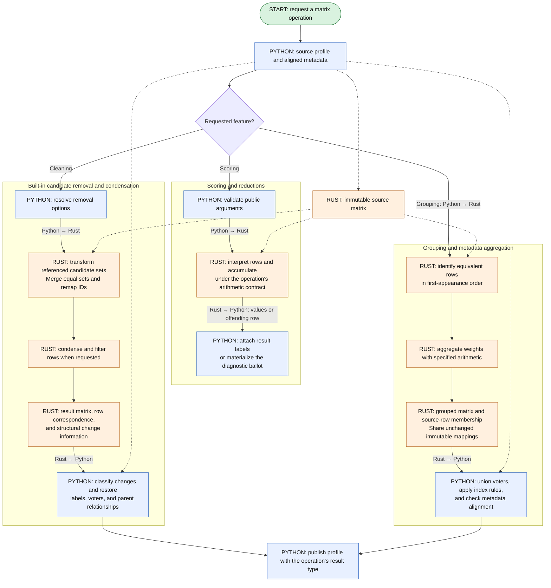

# Stage 3: port matrix computations to Rust

## Goal

Replace Python matrix computations with Rust implementations behind the interfaces completed in
[stage 1](stage-1-python-matrices/README.md). The consumers already request matrix operations, so
this stage changes where those operations execute rather than rewiring callers around another
representation. Each operation uses its Python implementation as the reference, subject to the
deliberate numerical changes in ADR 0005. Pairwise comparison retains its own adapter; FastSTV
remains outside the migration.

## Feature flow

Scoring, cleaning, and grouping share the immutable matrix but return different kinds of results.
The feature branches can be ported independently using the stage 1 operations as references and
stage 2 storage as their common input. Solid arrows show execution or returned data; dashed arrows
show retained references or shared storage.

## Rust work

Move scoring, mentions, grouping, concatenation, weight replacement, and built-in cleaning into
Rust matrix methods. These methods operate on owned storage and return results with the row
correspondence needed for provenance. Pairwise input preparation uses the matrix, but its existing
Numba tally kernel remains in place.

## Python work

Bind existing matrix methods to the Rust implementations and reconstruct Python metadata from
their results. Python keeps public wrappers, election-specific validation policy, error
construction, labels, cleaned-profile relationships, and arbitrary cleaning callbacks. Veto,
distance, search, and export consumers continue using the interfaces established in stage 1.
Preserve their Python orchestration while replacing the matrix computations underneath it.

## Operation contracts

An integer code identifies a ranking set, so an operation must either interpret that set or
establish the narrower singleton precondition. The matrix column is a ranking position, not
necessarily a positional-score index. `score_dict_from_score_vector` advances its score-vector
position by the size of each set: a three-candidate tie consumes three positions. It rejects
explicit empty sets and skips padding according to its existing rules.

Public cleaning includes more than the resulting matrix. The existing functions classify original
row labels, retain parents, distinguish semantic equivalence from a textual change, and expose
flags for dropping empty or zero-weight rows and retaining candidate declarations. Those rules
must survive even when no DataFrame is constructed during the operation.

Rounding, score coercion, and candidate membership follow the per-entry-point contract in the
[engineering notes](engineering-notes.md). In particular, directly multiplying raw score-array
values is not always equivalent to materializing `ScoreBallot` first: that constructor coerces
values to floats and drops zeros. Numeric scoring must reproduce the calculation's existing
boundary behavior under the current homogeneous score-storage contract.

## Relationship to existing acceleration

The Python reference already avoids repeated frozenset-to-code conversion around its NumPy
operations. Rust replacements follow the operation-specific arithmetic in
[ADR 0005](../../ADRs/0005-profile-numeric-contracts.md), including the deliberate change from
`math.fsum` to scalar Neumaier for float mentions. Pairwise comparison continues to use the Numba
kernel with its existing arithmetic and skip/stop semantics.

General and no-ties scoring can share extraction, membership, and output construction while
keeping their distinct reductions. A common implementation is useful only where it preserves those
numerical boundaries.

### Scoring and reduction flow

The Python wrapper retains public validation, result keys, and diagnostics. Rust interprets the
encoded rows and applies the operation's arithmetic, including the selected Neumaier reduction
where ADR 0005 specifies it.

## Design decisions and tradeoffs

### Mentions

Accumulate float mentions with the scalar Neumaier implementation used for total ballot weight.
Preserve the reference's candidate membership, contribution order, and repeated-candidate
multiplicity. Exact mentions continue to sum rational weights and convert completed totals to
floats at the public boundary. The Python wrapper retains validation and result construction while
Rust performs the reduction against matrix storage.

### First-preference and positional scoring

Use code-to-membership and code-to-size lookups prepared from the private table. For the no-ties
first-preference function, tally the first ranking column directly when the profile satisfies that
function's current assumptions. Preserve its validation, ignored-code behavior, output keys, and
final rounding. Profiles outside the equivalent subset retain the reference operation. Extend the
existing direct matrix path without restoring its former positional-vector round trip.

General positional scoring follows the reference's row and ranking-set order. Cumulative set size
determines the score-vector slice, to which the operation applies `high`, `low`, or `average`
before rounding at the existing boundary. Rust membership tables replace Python set traversal
without requiring a three-dimensional ballot-by-rank-by-candidate tensor, and the numeric Python
implementation remains the executable reference.

Score-ballot totals use ordered score columns with the operation's existing coercion and
missing-value rules. Distinguish all-missing rows, explicit zeros that materialize as an empty
dictionary, and nonzero scores on zero-weight rows. Validate before interpreting missing entries
as arithmetic zeros. Preserve candidate output keys even when their totals are zero.

### Built-in cleaning

Candidate removal computes a replacement set for each observed code, interns equivalent result
sets, and applies the resulting lookup to the ranking array. The NumPy reference performs set work
once per distinct code. Preserve the distinction between padding and explicit empty positions even
when neither contains a remaining candidate.

Compaction removes positions according to the specific cleaning function and pads to the required
width. Removing repeated candidates is row-dependent: a candidate seen earlier in the row changes
the meaning of a later set. Track seen candidates per row because a single global replacement
table cannot capture that dependency.

Classify source rows by their public labels before applying the requested filters, then return
provenance with the numeric result. This preserves the combined removal/condensation functions'
treatment of trailing empty positions as equivalent. It also allows already empty rows to appear
in both unchanged and no-ranking categories, as the existing contract permits.

For scored cleaning, candidate removal changes the value columns and candidate metadata with the
same retention rules as the baseline. Preserve all-missing, all-zero, and zero-weight cases and
their distinct classifications. Reconstruct `CleanedScoreProfile` directly from validated storage
and provenance.

#### Built-in cleaning flow

Candidate removal transforms referenced sets once and remaps the encoded rows. Condensation and
row filtering follow the requested cleaning policy. The result includes enough correspondence to
reconstruct provenance without matching exported profiles.

### Grouping and addition

Keep row multiplicity until an explicit grouping call. Group by decoded ranking meaning or by
codes from a reconciled table; never compare codes from different tables directly. Preserve group
order, voter-set union, index reset, and the warning/type change when
grouping a cleaned profile. The current matrix contract uses first-appearance group order and
canonical set meanings; historical pandas ordering and code assignments are not required.

Float grouping uses one scalar Neumaier accumulator per group, with contributions in source-row
order and each corrected total finalized after its last contribution. This deliberately replaces
the Python reference's weighted `np.bincount` reduction under
[ADR 0005](../../ADRs/0005-profile-numeric-contracts.md). Exact grouping retains rational sums.
Check the revised float totals and any affected election decisions separately from group
membership, order, and metadata parity.

Python grouping and concatenation already belong to the matrix modules. Port those operations
behind the same interface rather than reintroducing a DataFrame route. During an incremental port,
a Python reference operation may need an explicit array export; keep that adaptation inside the
matrix implementation until the operation moves to Rust. Equality redesign is separate work.

#### Grouping and metadata flow

Rust determines group membership and aggregates weights. Python uses that same membership to
reconstruct voter metadata and apply the operation's index rules. Solid arrows show operations or
returned data; dashed arrows show retained references or shared storage.

The original profile remains valid. Group membership refers to source row positions rather than
public index labels, which may repeat. Grouping a cleaned profile still follows the existing
warning and result-type contract; carrying source metadata does not imply retaining every cleaning
relationship on the result.

### Callbacks

Keep `clean_rank_profile` and `clean_score_profile` compatible with arbitrary Python cleaning
functions. Preserve the callback's tuple contents, order of invocation, number of calls,
exceptions, and treatment of the returned row. That path may materialize labeled rows.

Built-in profile types call their numeric implementations directly while custom subtypes require
dispatch that respects supported validation and computation overrides. Eligibility must follow
known operation and type contracts because inspecting callback code cannot establish semantic
equivalence, and invoking it speculatively would itself change observable behavior.

## Implementation boundaries

Put storage interpretation and transformations in the relevant matrix module; retain election
policy, callback orchestration, and public error construction with their current owners. Avoid a
parallel `_operations.py` layer that duplicates matrix responsibilities. Trusted result
construction uses `_from_matrix` or its Rust equivalent with aligned metadata and established
invariants.

Exercise the scoring entry points in `utils/common_utils.py`, built-in profile cleaning, and
validators in `RankingElection` and `GeneralRating` through their stage 1 interfaces. Validators
continue using batched matrix queries and construct an offending ballot only when an error message
requires it. Matrix construction establishes structural validity; each election still checks its
own eligibility conditions at the existing error boundary. Verify supported overrides when binding
an operation to Rust.

Do not change `NumpySTVBase` or FastSTV as part of this migration. Their existing encoding and
capacity constraints are not the new matrix contract. FastSTV deprecation is planned for 4.0.

Retain the stage 1 `pairwise_dict` adapter. Preserve its validation of ballot presence, candidate
selection, pair order, and current undefined-set handling. Do not silently begin rejecting ties
because the STV adapter requires singleton rankings. Keep its existing Numba signature and
arithmetic until a separate Rust checkpoint proves an equivalent replacement.

## Suggested implementation steps

First-preference scoring, positional scoring, score totals, and cleaning offer useful boundaries
for incremental work. Combine related operations when they share enough machinery to make
implementation and review clearer; these boundaries do not prescribe separate pull requests or
releases.

1. Port first-preference, positional, mention, and score totals behind their existing matrix
   interfaces, retaining Python wrappers and numeric validators.
2. Port ranked candidate removal/compaction, repeated-candidate removal, and scored candidate
   removal with their cleaning provenance.
3. Port grouping, concatenation, weight replacement, and rank-to-score conversion with their row
   correspondence and candidate mappings.
4. Port the matrix queries and reductions used by veto, distance, candidate-matrix,
   representation, and search consumers. Preserve the pairwise adapter and its existing Numba
   tally kernel.

The [stage 1 checklist](stage-1-python-matrices/README.md#consumer-checklist) owns the
package-wide consumer inventory. Use its Python implementations and tests to guide each Rust
replacement. Callback cleaning may need Python row materialization; it does not require an
intermediate full DataFrame.

## Verification

Use differential tests that compare output keys and order, exact values where specified, warnings
and prints, errors, and every field of a cleaned result. Test tied sets larger than two and
score-vector slices crossing a tie boundary. Include internal empty sets, trailing padding,
repeated candidates within and across tied sets, empty profiles, zero weights, and declared
candidates absent from the votes.

Use callback fixtures that record invocation order and raise at a chosen row. Confirm that
built-in acceleration does not change the public callback path or invoke it speculatively. Check
custom profile subtypes with overridden accessors as well as election subclasses. Check cleaned
parent chains, category overlaps, candidate retention flags, and public index labels that differ
from physical row positions. Validate result code dictionaries, reserved IDs, and each ID-to-set
correspondence alongside decoded ballots. Require identical numeric ID assignments only where an
entry point explicitly promises them; equivalent matrix-local remapping is otherwise valid.

Exercise candidate and ranking dimensions beyond narrow index ranges for the new adapters. Treat
cases beyond the historical implementation's range as capacity tests, with class-specific parity
checks for inputs both versions accept. Invalid private adapter payloads must fail before indexing
or allocation based on their codes.

Run the affected scoring, cleaning, metric, and election tests. Confirm that successful numeric
paths do not populate public `.df` or `.ballots` caches while error reporting and callbacks retain
their required materialization behavior.

## Intended outcome

The activated scoring and cleaning operations work directly on matrix storage and preserve their
accepted public contracts. Pairwise conversion no longer reconstructs labeled rankings before
recoding them; FastSTV remains unchanged. Ordinary and exact Python reference paths remain
available, and stage 4 can use these operations without pandas inside its transition loop.
