# Stage 4: retained election workspaces and policy hooks

## Goal

Run ordinary STV in a Rust-owned workspace over immutable profile storage, retaining enough
information to reconstruct every public round. Counting and history materialization become
separate operations under the contract in [ADR 0002](../../ADRs/0002-retained-stv-transitions.md).

Custom algorithms outside the Rust runner retain compatible Python execution. Municipal rule
implementations remain separate work, and FastSTV's counting algorithm is unchanged.

## Feature flow

The subgraphs follow one count from profile ingestion through setup, round progression, tiebreak
dispatch, retained history, and replay. Python callbacks return validated choices to the pending
Rust action. Replay reads recorded effects without repeating decisions or random draws. Solid
arrows show execution or returned data; dashed arrows show retained references or shared storage.

```mermaid
flowchart TD
    START(["START: user supplies ballots, a DataFrame, or arrays"])

    subgraph SETUP["Profile ingestion and count setup"]
        INPUT["PYTHON: normalize and encode input<br/>Retain labels, voters, and provenance"]
        MATRIX["RUST: validate and own profile storage"]
        PROFILE["PYTHON: construct RankProfile<br/>User calls STV(profile, seats, rules)"]
        POLICIES["PYTHON: resolve eligibility, policies, and callbacks"]
        WORKSPACE["RUST: create private count workspace<br/>Share immutable rankings"]
        INITIALIZE["RUST: calculate quota, allocate ballots,<br/>and compute initial tallies"]
        INPUT -->|"Python → Rust"| MATRIX
        MATRIX -->|"Rust → Python: handle"| PROFILE --> POLICIES
        POLICIES -->|"Python → Rust"| WORKSPACE --> INITIALIZE
        MATRIX -.-> WORKSPACE
    end

    subgraph ROUNDS["Round progression"]
        FILLED{"All seats filled?"}
        REMAINING{"Remaining candidates ≤ unfilled seats?"}
        ALL["RUST: elect all remaining candidates"]
        QUOTA{"Any candidate reaches quota?"}
        ELECT_SELECT["RUST: select candidates to elect"]
        ELIM_SELECT["RUST: select candidates to eliminate"]
        TIE{"Tie prevents selection?"}
        ACTION{"Resume pending action"}
        ELECT["RUST: elect selected candidates"]
        ELIMINATE["RUST: eliminate selected candidates"]
        LAST{"All seats filled?"}
        SURPLUS["RUST: apply surplus-transfer policy<br/>Dispatch custom hook when configured"]
        ADVANCE["RUST: advance affected ballots<br/>Update exhaustion and tallies"]
        DONE["RUST: finalize terminal effects"]
        FILLED -->|Yes| DONE
        FILLED -->|No| REMAINING
        REMAINING -->|Yes| ALL --> DONE
        REMAINING -->|No| QUOTA
        QUOTA -->|Yes| ELECT_SELECT --> TIE
        QUOTA -->|No| ELIM_SELECT --> TIE
        TIE -->|No| ACTION
        ACTION -->|Elect| ELECT --> LAST
        ACTION -->|Eliminate| ELIMINATE --> ADVANCE
        LAST -->|Yes| DONE
        LAST -->|No| SURPLUS --> ADVANCE
    end

    subgraph TIEBREAK["Rust or Python tiebreak"]
        CONTEXT["RUST: tied candidates, selection count,<br/>reason, and required history"]
        DISPATCH{"Configured implementation?"}
        RULE["RUST: resolve tie"]
        RELEASE["RUST: release incompatible borrows<br/>Prepare owned callback inputs"]
        CALLBACK["PYTHON: invoke custom tiebreak"]
        VALIDATE["RUST: validate and retain choice<br/>with the pending action"]
        CONTEXT --> DISPATCH
        DISPATCH -->|Rust| RULE --> VALIDATE
        DISPATCH -->|Python| RELEASE
        RELEASE -->|"Rust → Python"| CALLBACK
        CALLBACK -->|"Python → Rust: choice"| VALIDATE
    end

    subgraph HISTORY["Retained transitions and public history"]
        RECORD["RUST: retain completed transition<br/>Callback effects, row changes, and terminal status"]
        LOG["RETAINED HISTORY<br/>Original input, transitions, and matching summaries"]
        SUMMARY["PYTHON: immutable completed-round summary"]
        TERMINAL{"Terminal transition?"}
        RESULTS["PYTHON: expose completed election results"]
        RECORD --> LOG
        RECORD -->|"Rust → Python"| SUMMARY
        RECORD --> TERMINAL
        TERMINAL -->|Yes| RESULTS
    end

    subgraph REPLAY["Requested round reconstruction"]
        REQUEST(["USER: get_profile(round) or get_step(round)"])
        INDEX["PYTHON: resolve index against recorded rounds"]
        REBUILD["RUST: apply retained effects in a fresh workspace<br/>No callbacks or random draws"]
        ROUND["RUST: round matrix and row correspondence"]
        WRAP["PYTHON: restore labels, voters, and provenance<br/>Attach matching summary for get_step"]
        REQUEST --> INDEX
        INDEX -->|"Python → Rust"| REBUILD --> ROUND
        ROUND -->|"Rust → Python"| WRAP
    end

    START --> INPUT
    INITIALIZE --> FILLED
    TIE -->|Yes| CONTEXT
    VALIDATE --> ACTION
    ADVANCE --> RECORD
    DONE --> RECORD
    TERMINAL -->|No| FILLED
    INPUT -.-> LOG
    MATRIX -.-> LOG
    LOG -.-> INDEX
    LOG -.-> REBUILD
    LOG -.-> WRAP
    RESULTS --> REQUEST
    class INPUT,PROFILE,POLICIES,CALLBACK,SUMMARY,RESULTS,INDEX,WRAP python;
    class MATRIX,WORKSPACE,INITIALIZE,ALL,ELECT_SELECT,ELIM_SELECT,ELECT,ELIMINATE,SURPLUS,ADVANCE,DONE,CONTEXT,RULE,RELEASE,VALIDATE,RECORD,REBUILD,ROUND rust;
    class START,REQUEST start;
    classDef python fill:#e8f0ff,stroke:#356ac3,color:#111;
    classDef rust fill:#fff0df,stroke:#b86b25,color:#111;
    classDef start fill:#d9f2df,stroke:#26783b,color:#111;
```



## Rust work

Implement the count-local workspace, built-in STV policy, tallies, transfers, cursor advancement,
transition records, and replay. The Rust runner controls progression and invokes Python only at
supported custom-policy events. Exact execution uses GMP throughout.

## Python work

Keep the election entry points, parameter validation, custom hooks, and public result types. Bind
supported elections to the Rust runner, publish immutable `ElectionState` values, and reconstruct
profiles and provenance from Rust replay results. Update composite elections to create replacement
summaries when renumbering rounds. Unsupported custom counting algorithms retain Python execution.

## Execution boundary

`Election.__init__` continues to honor Python execution hooks. A Rust base implementation must not
bypass a subclass's `_run_election` or `_run_step` override. Python-defined elections can
therefore retain their own execution model without a Rust counterpart.

For supported counts, a synchronous Rust runner implements built-in policy and performs tallies,
transfers, filtering, and traversal. It shares the matrix's rankings and original weights, using a
small set-to-candidate lookup after validating singleton eligibility. Current weights or factors,
cursors, candidate activity, live row order, and transitions belong to the count.

Custom tiebreaks and transfers enter through explicit Python events. Define each event's inputs
and result type: a tiebreak generally needs candidate-scale context whereas an arbitrary transfer
may need ballots or a profile. Validate the result before applying it. Ordinary Rust rounds incur
none of that materialization and preserve the existing quota, surplus, elimination, exhaustion,
tie, and RNG rules.

## Rule-set orchestration

An internal `STVRuleSet` supplies the policies used by the runner. The workspace owns count state;
the rule set chooses actions, and the runner validates, applies, and records their effects. Giving
the rule set control over action order leaves room for procedures that distinguish election from
surplus transfer without embedding those choices in workspace operations.

The diagram above groups setup, round progression, and tiebreak dispatch within one count. It
describes the current quota-based STV policy; future municipal rules may choose a different action
sequence.

### Count setup flow

Profile construction follows [stage 2](stage-2-array-storage.md#construction-flow). The count then
shares immutable rankings while keeping its weights, cursors, and tallies private. It needs the
relevant storage and operations from stages 2–3, not every matrix operation.

### Round progression flow

Selection enters the tiebreak subgraph whenever a tie prevents an election or elimination.
Surplus-transfer hooks use the same validated dispatch pattern. Every completed round, including
terminal completion, retains its effects before results are exposed.

### Tiebreak dispatch flow

Both election and elimination selection enter the tiebreak subgraph. A choice returns to the
pending action; the Python callback does not mutate the workspace. Its validated result is
retained with the action so replay does not invoke the callback again.

### Dispatch sketch

Each policy has its own context and result type. A tiebreak context includes the tied candidates,
the number to select, the reason for selection, and any required completed history. Both Rust and
Python implementations return a choice to the pending operation rather than mutate the workspace.
If a rule also requires a choice between pending surplus transfers, that is a distinct tie
context.

The Rust sketches below explore this division of responsibility. Supporting types and Python
conversions are omitted. Enum variants, context structures, helper boundaries, and transition
granularity can change as the implementation develops. Preserve the ownership boundary, validated
callback results, public round behavior, and information needed for replay. The examples do not
establish a public registration API.

```rust
struct STVRuleSet {
    quota: QuotaPolicy,
    next_action: NextActionPolicy,
    transfer: TransferPolicy,
    tiebreak: TiebreakPolicy,
}

enum TiebreakPolicy {
    Rust(fn(&TieContext) -> Result<TieResolution, RuleError>),
    Python(Py<PyAny>),
}

impl TiebreakPolicy {
    fn resolve(&self, context: &TieContext) -> Result<TieResolution, RuleError> {
        match self {
            Self::Rust(resolve) => resolve(context),
            Self::Python(callback) => call_python_tiebreak(callback, context),
        }
    }
}

```

The quota, next-action, and transfer policies follow the same Rust-or-Python pattern with their
own contracts. Function pointers illustrate stateless Rust policies; configured Rust policies can
use concrete Rust types carrying their parameters. The Python adapter acquires interpreter access,
converts the context, invokes the callback, and parses its result. Contexts contain owned values
or safe immutable handles so no incompatible workspace borrow survives the call.

### Selecting the next action

`NextActionPolicy` decides what should happen given the current count state: elect candidates,
transfer a pending surplus, eliminate candidates, or complete the count. It selects the action
without changing weights, advancing ballot cursors, or mutating candidate activity. Those changes
belong to the workspace and are applied by the runner.

The policy reads candidate-scale state rather than individual ballots:

```rust
struct DecisionContext<'a> {
    seats_remaining: usize,
    quota: &'a Weight,
    tallies: &'a CandidateTallies,
    continuing: &'a [CandidateId],
    pending_surpluses: &'a [PendingSurplus],
    history: &'a [RoundSummary],
}

enum NextActionPolicy {
    Rust(fn(&DecisionContext<'_>) -> Result<NextAction, RuleError>),
    Python(Py<PyAny>),
}
```

`Weight` represents the count's floating or exact arithmetic. References in this sketch borrow
immutable snapshots or safely shared values; they must not hold a workspace borrow that prevents a
Python callback from inspecting completed rounds. The Python adapter exposes the same information
without writable access to count state.

An unresolved selection tie is an explicit result. The runner can therefore invoke the configured
tiebreak in either language before resuming the pending action:

```rust
enum NextAction {
    Ready(RoundAction),
    NeedsTiebreak(PendingSelection),
}

enum RoundAction {
    Elect { candidates: Vec<CandidateId> },
    TransferSurplus { candidate: CandidateId },
    Eliminate { candidates: Vec<CandidateId> },
    Complete,
}

enum PendingSelection {
    Elect(SelectionTie),
    Eliminate(SelectionTie),
    TransferSurplus(SelectionTie),
}

struct SelectionTie {
    already_selected: Vec<CandidateId>,
    tied_candidates: Vec<CandidateId>,
    places_needed: usize,
}
```

`already_selected` preserves candidates whose selection is unambiguous when only part of a group
is tied. If a rule needs two candidates and one is already determined, the tiebreak selects only
the remaining candidate. The pending variant identifies the purpose of that choice. In this
sketch, surplus selection resolves to one candidate because `RoundAction::TransferSurplus`
transfers one surplus. A different action representation may combine transfers when it preserves
their policy, arithmetic, and replay semantics.

The policy determines when the count is complete, when all remaining candidates should be elected,
which election or surplus transfer is due, and when elimination is required. Their precedence
belongs to the policy. The first implementation preserves the existing STV sequence rather than
imposing a new order through the runner.

The rule set's selection method can resolve these alternatives as follows:

```rust
impl STVRuleSet {
    fn choose_next_action(
        &self,
        context: &DecisionContext<'_>,
    ) -> Result<RecordedDecision, RuleError> {
        let next_action = self.next_action.choose(context)?;
        validate_action_proposal(&next_action, context)?;

        match next_action {
            NextAction::Ready(action) => {
                Ok(RecordedDecision::without_tiebreak(action))
            }
            NextAction::NeedsTiebreak(selection) => {
                let tie_context = selection.build_context(context);
                let resolution = self.tiebreak.resolve(&tie_context)?;

                selection.resolve_and_record(resolution)
            }
        }
    }
}
```

`NextActionPolicy::choose()` dispatches like `TiebreakPolicy::resolve()`. Proposal validation
checks candidate eligibility, uniqueness, and selection counts before a tiebreak can consume
randomness or invoke Python. `resolve_and_record()` validates the returned choice, combines it
with any candidates already selected, and retains the resolution alongside the resulting action. A
Python next-action policy that needs a tie resolved returns `NeedsTiebreak` so the runner can
record that decision.

### Applying and recording actions

The runner can then follow this structure:

```rust
loop {
    let context = workspace.decision_context();
    let decision = rules.choose_next_action(&context)?;
    workspace.validate_decision(&decision)?;

    let transition = prepare_transition(&workspace, &rules, decision)?;
    workspace.validate_transition(&transition)?;
    let complete = transition.completes_count();

    workspace.apply_transition(&transition);
    history.record(transition);

    if workspace.public_round_complete() {
        history.publish_round(workspace.summary());
    }
    if complete {
        break;
    }
}
```

`choose_next_action()` resolves any required selection tie and returns the action together with
its decision record. `prepare_transition()` obtains transfer results when needed and retains
callback effects for replay. All policy calls and validation finish before the transition is
applied. Recording transitions separately from publishing summaries permits several actions within
one public round. Completion records the terminal profile and summary under the same contract.

Replay consumes these records without invoking the rule set. The initial implementation supplies
existing STV behavior; municipal rule implementations and public registration remain separate
work.

## State and transition ownership

Original input and retained transitions provide replay without storing a complete ballot matrix
for every round. Summaries record ordered remaining, elected, and eliminated groups, scores, and
tiebreak outcomes. Exact scores are exposed as Python Fractions.

Elimination, election/transfer, and terminal completion require distinct records, each containing
the policy choice, transfer factors, grouping, and row-order effects needed to reproduce that
transition. Store factors directly rather than recovering them from rounded scores, and retain row
order wherever it influences floating reduction.

Filtering must follow the transition's semantics. A simultaneous transfer can retain a row that
becomes empty only after peer removal; a generic exhausted-row filter would lose that distinction.
Terminal completion records the resulting width and parent relationship, including the case in
which all remaining candidates fill the seats.

Replay applies records in a fresh workspace, using explicit row correspondence to recover labels,
voters, and cleaned parent/category metadata. This keeps repeated and out-of-order requests
independent of the original count, source profile, and RNG, including when several elections share
the same input.

### History retention flow

The count retains its original input and executed transitions. These records outlive the mutable
workspace and include callback effects, row correspondence, and terminal completion.

### Replay flow

Each request creates a fresh replay workspace. It reads retained transitions without consulting
the rule set, repeating callbacks, or drawing randomness. Requested profiles and summaries refer
to the same executed round.

## Python references and callback safety

Numerical state contains Rust values while binding owners may retain the Python labels and
summaries needed at the interface. Keep those references outside detached work and provide GC
traversal and clearing where cycles are possible. Call-scoped callbacks avoid retaining references
to a live election.

Before invoking Python, release incompatible Rust borrows and supply the required context
directly. Callbacks may query completed rounds. Recursive advancement and queries requiring a
partially applied transition fail explicitly. Callback errors propagate once without restarting
the count.

Record decisions or resulting transformations, including weights and row correspondence where
required. A custom transfer need not be expressible as one multiplier, so replay may require
retained result data. Persistence carries those effects; reconstruction never invokes the callback
again on a retained-workspace path.

## Public history

Assemble history in a private list, publishing completed rounds as immutable `ElectionState`
values through a read-only tuple attribute. To make each state immutable, copy its score and
tiebreak mappings into owned immutable storage as well as freezing the containing object.
Callbacks see only completed rounds, and `to_dict()` provides detached values for callers who need
an editable representation.

Every query addresses this recorded sequence: round zero represents the input, election length
excludes it, and negative indices resolve against the available rounds. Accordingly, `get_step()`
returns a profile with its matching summary while `get_status_df()` presents the same history as a
DataFrame. Neither item assignment nor replacement of the history attribute can alter the executed
count.

This separation of assembly from publication changes the current mutable interface, requiring an
audit of internal and supported subclass construction hooks. TopTwo and Alaska, for example,
currently renumber states from other elections and must instead construct replacements. FastSTV
also needs verification against the shared history interface, with its counting algorithm left
unchanged.

Legacy custom algorithms retain their existing reconstruction behavior, including possible
callback repetition. Extending deterministic replay to them requires retained outputs or
snapshots. A common Rust history owner is optional: Python may hold immutable summaries while Rust
owns the count and transitions.

## Eligibility and persistence

Determine eligibility from the complete profile and election configuration before mutation or RNG
consumption. Matrix construction establishes general structure; the count checks singleton and
policy preconditions. Valid profiles outside the Rust domain, including unsupported zero-weight
cases, use the compatible path. Election eligibility does not narrow the general profile contract.

Weights follow [ADR 0005](../../ADRs/0005-profile-numeric-contracts.md). Exact-mode conversion
rejects nonintegral floats, and exact quotas, comparisons, tallies, and transfers remain rational.
Supported arithmetic hooks must preserve that contract.

Serialize authoritative input, metadata, and transitions in a versioned format. Restore into a
checked temporary owner before publication, preserving profile/parent sharing. Baseline fixtures
must cover conversion of historical mutable summaries into immutable values with the same content
and round order. Legacy payloads without transitions retain their reconstruction limitation;
summaries alone do not establish the effects of an arbitrary callback.

## Suggested implementation steps

These areas can develop together around a small supported count, using its execution and replay to
refine the interfaces before extending them to more configurations.

1. Introduce immutable states and private history assembly, including composite elections,
   dictionary exports, and compatibility fixtures.
2. Establish retained workspace ownership and a Python reference path.
3. Integrate the Rust runner, shared matrix buffers, the internal `STVRuleSet`, and Python events.
4. Complete callback records, replay, provenance, and persistence before activating each path.
5. Explore traversal and arithmetic optimizations as working counts expose opportunities, checking
   their effects on the complete count and replay behavior.

Exact and floating workspaces may share mechanics while preserving their different arithmetic.
[Exact STV](exact-stv.md) develops cursor advancement, incremental exact tallies, and shared
factors. Changes to floating reduction order require explicit validation against the numerical
contract.

## Verification

Compare every round's scores, candidate order, ties, rows, weights, metadata, cleaned parents, and
terminal profile, together with exceptions and final RNG state. Include independent counts and
reverse-order replay. Retained replay must leave callback invocation counts and RNG state
unchanged; legacy reconstruction is tested under its narrower contract.

Binding tests cover callback errors and reentrancy, GC, persistence relationships, rejected
history mutation, input isolation, detached dictionary exports, and composite round numbering.

Validate the complete election interface against the Python reference, including repeated history
access. Numerical tolerance does not excuse changed election decisions.
