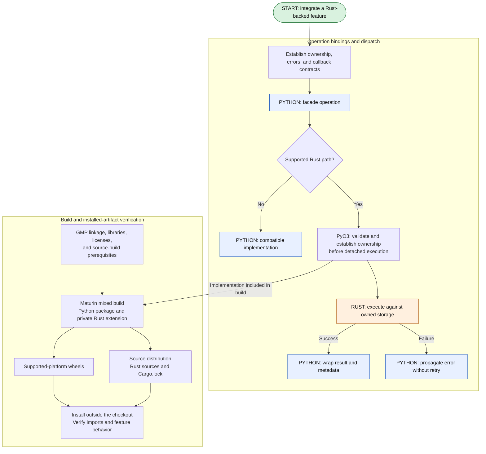

# Stage 5: Rust boundaries, dispatch, and distribution

## Goal

Ship the Python package and private `votekit._votekit_core` extension as one distribution under
[ADR 0003](../../ADRs/0003-private-rust-distribution.md). Rust operations remain behind the
profile and matrix interfaces. Activation requires behavioral parity and working installed
artifacts on the supported platforms.

## Feature flow

Bindings and distribution accompany each Rust feature. The first subgraph follows a runtime call;
the second shows how the implementation reaches installed packages. The labeled connection denotes
a build dependency, not a runtime step.

## Rust work

Develop the private PyO3 extension alongside the first Rust owners and operations. Carry a small
operation through the binding and an installed package early, then extend array adaptation,
exception translation, Python reference handling, detached execution, and GMP linkage as they are
needed. Packaging and binding constraints can then inform the design while it is still taking
shape.

## Python work

Wire the facades and dispatch into the extension, replace Hatchling with the Maturin mixed build,
and update package contents and release configuration. Preserve public imports, typing
information, extras, and bundled data. Add installed-wheel and source-distribution checks outside
the checkout.

## Rust ownership boundary

Python adapters validate external input and transfer owned values into Rust matrices. Internal
results may move or share validated allocations without a NumPy export/import cycle. PyO3 and
rust-numpy provide the binding and array adaptation; validation covers dimensions, dtype, byte
order, strides, membership, bounds, alignment, and allocation arithmetic.

Before computation detaches, ownership must establish the allocation's lifetime and immutability;
a read-only NumPy flag provides neither guarantee. Public exports therefore copy while private
operations use Rust methods and shared immutable allocations. Where binding owners retain Python
references, they also provide GC and callback lifetime handling.

General ranked operations consume set IDs and membership tables. Singleton elections impose
narrower preconditions while sharing the same rankings. Python retains labels and provenance
through explicit row maps and group membership. Internal indices never substitute for public
identities.

## Execution and policy

Bindings expose complete operations or batches of queries, returning the offending row and context
when validation fails so Python can materialize just the ballot needed for the error. Preserve
error precedence while distinguishing general profile validity from eligibility for a Rust
operation.

The Rust runner follows [stage 4](stage-4-election-state.md): built-in policy executes in Rust,
and explicit Python hooks supply custom behavior. Hook results are validated and their effects
retained for replay. Unsupported custom algorithms retain Python execution with its existing
reconstruction limits. GMP supplies exact arithmetic for the Rust implementation.

Select execution before mutation or RNG consumption. Rust failures propagate without retry, and a
missing extension is an installation error after Rust ownership is activated. A private reference
override may support differential tests, but must state whether it changes kernels, storage, or
both.

### Operation binding flow

Dispatch selects a supported path before mutation or random draws. Once Rust execution begins,
failures propagate without retrying through Python. Policy callbacks use the separate event
boundary described in stage 4.

## Distribution contract

Replace Hatchling with a Maturin mixed build while preserving `src/votekit`, public imports,
metadata, extras, `py.typed`, and generator JSON data. Include Rust sources and `Cargo.lock` in
source distributions. Record GMP and binding dependencies, licenses, linkage, bundled-library
requirements, and source-build prerequisites.

Target VoteKit's supported CPython versions on Linux glibc x86_64/aarch64, macOS x86_64/arm64, and
Windows x86_64. Reconfirm that matrix and the minimum Rust toolchain during implementation. PyPy,
free-threaded Python, WASM, and a separate pure-Python distribution are outside the initial scope.

Supported wheels require no compiler on the user's machine although development and source builds
use the documented toolchain. To verify that distinction, install each release target's wheel
outside the checkout and exercise ordinary and exact computation, with equivalent independent
build checks for source distributions. Existing publishing authorization and trusted-publishing
controls remain in force.

### Distribution flow

The mixed build ships Python and Rust together. Exact support brings GMP's linkage and
distribution requirements into that build. Verify the wheel and source distribution outside the
checkout so local files cannot conceal missing package contents.

## Verification required for release

Rust unit tests cover valid and invalid construction, empty dimensions, bounds, sentinels,
transformations, exact arithmetic, replay, and allocation checks. Binding tests add ownership,
exports, callback mutation and errors, reentrancy, GC, and persistence.

Python differential tests compare values, metadata, contractual order, extensions, exceptions, and
RNG state. Include arbitrary-size rationals within the total cap and vary hash seeds where label
iteration affects behavior.

Installed-artifact tests exercise construction, transformations, ordinary and exact elections,
fallback hooks, and replay. These checks establish support for the distributed artifacts rather
than only the development build.
