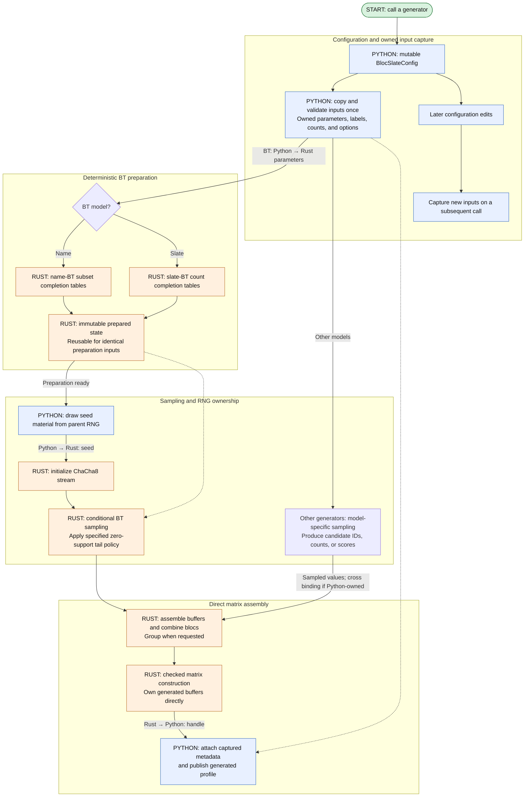

# Stage 6: direct matrix generators and Bradley–Terry sampling

## Goal

Construct matrices directly from sampled numeric results and port the Python/NumPy Bradley–Terry
implementation to Rust. The sampling algorithms are assumed to be implemented before this
migration; this stage develops their ownership, bindings, and integration with profile storage.

Direct construction removes intermediate ballots and DataFrames. Porting preparation and sampling
lets their buffers become Rust-owned profile storage without a Python array round trip.
[ADR 0001](../../ADRs/0001-profile-array-ownership.md) establishes ownership of those buffers.

## Feature flow

One generation call captures independent inputs, prepares the required sampling state, and builds
a profile from sampled buffers. Subgraphs separate those responsibilities while showing which
state crosses the Python/Rust boundary. Solid arrows show execution or returned data; dashed
arrows show retained inputs or preparation. The diagram shows one RNG stream; per-bloc stream and
batching contracts are described below.



## Rust work

Port the Python/NumPy name-BT subset tables, slate-BT count tables, and conditional samplers. Rust
sampling uses a seed supplied by Python and returns buffers directly to Rust profile storage. Move
numeric assembly of sampled IDs and counts into Rust matrix construction, including grouping and
combination of bloc outputs.

## Python work

Implement atomic `BlocSlateConfig` edits and owned generation-input capture. Preserve the one-off
generator functions, configuration diagnostics, candidate labels, and parent RNG. Replace
ballot/DataFrame assembly with direct matrix construction where that provides a useful
intermediate step. Use the Python/NumPy sampling implementation as the behavioral reference and
connect its public entry points to the Rust port. Other generators retain their model-specific
sampling code while adopting the same matrix construction path.

## Configuration editing and generation inputs

[ADR 0007](../../ADRs/0007-bloc-slate-configuration.md) describes configuration editing and owned
generation inputs. Sampling needs validated inputs independent of later configuration edits; that
capture boundary can be developed with the sampler. The broader editing improvements can proceed
alongside it without becoming a prerequisite for every generator port.

The following work develops those responsibilities and can be divided to suit the implementation:

1. Centralize structural updates in the configuration. Prepare dependent tables and recipe changes
   before publication, keeping collection wrappers attached without recursive setters or
   invalidation flags.
2. Implement recipe lifetime and independent copying, preserving malformed direct table edits for
   validation to report.
3. Construct private immutable generation inputs with owned nested data. The prototype's
   `_prepare_generation_inputs()` and `_GenerationInputs` provide a starting point, not a public
   API.
4. Capture once per public call. Combined and by-bloc implementations receive the same validated
   inputs rather than recapturing the mutable configuration through nested calls.
5. Test failed updates, retained collection references, intermediate-state warnings, independent
   copies, malformed tables, recipe transitions, and sampling failures. Subsequent edits must
   leave captured inputs unchanged and be checked on the next call. Isolate capture behavior in
   tests so changes to seeded output can be attributed to sampling changes rather than
   configuration edits.

### Input capture flow

Capture occurs once per public call. Configuration remains editable, but subsequent edits cannot
change the inputs or prepared state used by the current call.

## Direct matrix construction

Keep sampled rankings as candidate IDs and counts until assembly, then translate once to
matrix-local singleton set IDs and combine bloc outputs before constructing the profile.
Throughout this process, preserve candidate metadata, requested grouping, and sampling semantics.

Impartial culture, impartial anonymous culture, spatial models, name Plackett–Luce, name BT, and
shared slate assembly provide useful starting points. Port them individually or together where
shared construction makes a combined change easier to understand. Cumulative generators can
construct score matrices from count arrays, and existing NumPy sampling primitives can feed this
construction path directly.

Batching bounds temporary allocations although ungrouped output still grows with requested rows.
When grouping is requested, aggregate duplicate rankings before profile construction while
preserving weight and order. Slate-pattern counts alone do not determine complete ballot counts
because within-slate identity assignments may produce different rankings from the same pattern.

## Porting the Python/NumPy Bradley–Terry implementation

This outline assumes name-BT subset tables, slate-BT count tables, and conditional sampling
already have a Python/NumPy implementation. Use that implementation and its tests as the reference
for the Rust port, including zero-support tails, within-slate identity assignment, numerical
stabilization, and preparation reuse. Algorithm development is separate from this migration.

Port the preparation and sampling operations behind the existing generator functions. Preserve the
sampling distribution and supported input behavior while adapting storage and random streams to
Rust. The implementation may organize tables and traversal differently without turning the port
into another algorithm-design phase.

## Private preparation and reuse

Keep one-off generator functions as the public interface. Their implementation separates input
capture, table preparation, sampling, and matrix construction. Preparation retains owned
parameters rather than a live configuration; name tables are reusable only for identical supports
and indexing. New Dirichlet draws generally require new tables.

Voter count and bloc apportionment belong to each generation call, not to completion-table
identity. Combined and by-bloc entry points share the model implementation and captured inputs. A
public prepared-sampler object and implicit global caches remain deferred.

Start from the preparation and reuse behavior of the Python/NumPy implementation. Rust can
organize the work differently while retaining the same completion weights and conditional
probabilities. The following layout provides a starting point for that port without fixing the
eventual table representation.

### Name-BT preparation (possible optimization)

Preparation produces two quantities for each remaining-candidate subset: a completion total that
helps prepare larger subsets and a conditional CDF that the sampler uses to choose the next
candidate. The current Python implementation computes both through batched NumPy operations. The
Rust migration offers an opportunity to combine some of that work as it visits each subset's
members while leaving the underlying recurrence and sampling distribution unchanged.

#### Current NumPy preparation

For a subset `U` with `k` remaining candidates and candidate supports `s_i`, choosing `i`
contributes `(k - 1) * log(s_i) + log Z(U without i)`. This combines the support factor for
placing `i` first with the total weight of its possible continuations. The implementation stores
these log contributions in candidate-column order, assigning negative infinity to absent
candidates so they contribute zero weight.

Suppose the columns are A, B, C, and D and the remaining subset is `{A, B, D}`, encoded as
`0b1011`. If the combined weights of the suffixes beginning with those candidates are
`(27, 16, 0, 5)`, the log contributions are `(log(27), log(16), -infinity, log(5))`. Applying
`np.logaddexp.reduce` gives the log completion total, `log(48)`, without forming the unnormalized
weights explicitly. Subtracting this total from each contribution and exponentiating then gives
the conditional probabilities:

```text
Candidate:     A      B      C      D
Probability:  27/48  16/48   0     5/48
CDF:          27/48  43/48  43/48   1
```

The CDF comes from `np.cumsum` in candidate order. C repeats B's threshold because an absent
candidate occupies no probability interval. A final division by the cumulative row's last entry
ensures that the endpoint is one despite floating-point accumulation error; it has no effect in
the exact arithmetic shown above. Although C contributes nothing, its column still participates in
the array operations, including exponentiation and cumulative addition.

#### Proposed Rust preparation

The Rust version could compute the completion total with max-shifted log-sum-exp. Subtracting the
largest log contribution before exponentiation makes the largest resulting weight one and keeps
every exponential argument nonpositive. This avoids forming the original products although
contributions that are extremely small relative to the maximum can still underflow.

Finding that maximum does not require a separate scan: as the first traversal visits the subset's
set bits in ascending candidate order, it can compute each log contribution and updates a running
maximum. A second traversal can then exponentiate the shifted contributions and add each weight
directly to a scalar Neumaier accumulator. The two traversals combine contribution calculation
with maximum selection, then exponentiation with compensated summation, reducing the total number
of operations.

In the example, the maximum is `log(27)`. Subtracting it before exponentiation produces
`(1, 16/27, 0, 5/27)`, whose compensated sum approximates `48/27`. Restoring the scale gives the
log completion total: `log(27) + log(48/27) = log(48)` in exact arithmetic. That total is stored
for use when preparing larger subsets.

The CDF can then be built directly from the shifted weights because their common scale cancels
during normalization. Ordinary cumulative addition gives `(1, 43/27, 43/27, 48/27)`, and dividing
by the last entry recovers `(27/48, 43/48, 43/48, 1)`.

A dense CDF lets the sampler retain its existing candidate-column indexing. Keeping that layout
also means initializing absent weights and writing every column, so the optimization reduces
arithmetic without changing the table's exponential growth. For `m` candidates, preparation still
takes `O(m * 2**m)` work and the retained float64 table occupies `8 * m * 2**m` bytes, excluding
preparation buffers.

### Sampling loops and further refinements

Retain linear CDF scanning as the initial Rust lookup and reuse the PL sampler's candidate-order
buffer where it already supports within-slate assembly. Binary CDF search, a special two-slate
threshold branch, and direct PL output writes are alternatives to revisit if the workload or
surrounding implementation changes; they are not prerequisites for this port. Preserve the rule
that a draw selects the first strictly larger threshold, including across repeated thresholds.

Narrower checked candidate IDs, compact CDF rows, and grouping sampled batches are possible later
refinements to memory use. Their value depends on the additional indexing, conversion, and
aggregation work they introduce. Parallel sampling is a separate option once deterministic stream
assignment and output ordering are established. None of these choices needs to block direct Rust
ownership or the preparation layout above.

Shared-prefix count sampling is separate algorithm work unless the Python implementation already
provides it. Preserve the existing MCMC option and its burn-in and retained-sample semantics; a
failed allocation must not silently select a different sampler.

### BT preparation flow

The Python/NumPy reference defines the completion weights and conditional probabilities. Rust
preparation preserves those distributions without consuming randomness; name and slate BT use
different state spaces.

## Randomness and Rust integration

Python owns the parent RNG and draws the seed material for Rust's ChaCha8 RNG, after which
sampling proceeds without a Python call per draw. Input capture and deterministic preparation
consume no randomness. Given a documented seed or initial state, sampling is reproducible within a
fixed package version though samples may change between minor versions.

As the sampler is integrated, define seed encoding and draw boundaries, per-bloc streams,
zero-ballot bloc behavior, batching, and random tail tiebreaks. Test the relationship between
combined/by-bloc and grouped/ungrouped calls. Post-sampling grouping can preserve the draw
sequence; direct count sampling requires its own documented stream behavior. Neither a global RNG
nor implicit reseeding is introduced. Election tiebreak streams retain their separate contract.

Port completion tables and conditional sampling to Rust, using the Python/NumPy implementation and
its small enumerated cases to check the distribution. Python retains configuration validation and
labels; Rust owners retain tables and numeric results. Those results enter a profile directly,
with alignment and candidate/weight invariants checked before publication. Generators remain
independent of quotas, election policies, and mutable workspaces.

### Sampling and matrix assembly flow

For BT, sampling starts with prepared completion tables. Other generators can enter matrix
assembly with their own sampled IDs, counts, or scores. This diagram shows one stream; seed
encoding, per-bloc streams, batching, and random tail tiebreaks retain the contracts described
above.

Preparation is independent of the sampling RNG. Reusing valid tables does not require retaining
the editable configuration or reusing an advanced RNG.

## Resource admission

Carry forward the Python implementation's resource policy, adapting allocation estimates to Rust
storage for preparation, all resident bloc tables, temporary allocations, grouping, and output.
One float64 value per name subset requires 8 MiB at 20 candidates, 256 MiB at 25, and 8 GiB at 30,
before other storage. Batching cannot reduce this table requirement.

Use checked arithmetic to calculate state products, byte counts, and platform conversions,
followed by fallible large allocations where possible. Grouped output must be budgeted for the
worst-case number of distinct rankings rather than an assumed duplicate rate. When allocating a
new sample, check current availability without charging resident tables twice.

Host and applicable cgroup limits can guide conservative refusal but do not reserve memory.
Specify which failures precede caller RNG consumption; later allocation failures need not roll
back an advanced RNG. Resource errors propagate without changing the model or sampler. Select
concrete limits from the production representation and its allocation requirements.

## Verification

Compare Rust preparation and conditional probabilities against the Python/NumPy implementation.
Reuse its small exhaustive-enumeration cases to check name and slate normalizers and ranking
probabilities. Check conditional sums and products along positive-support rankings. Include uneven
supports, zero-support tails, single candidates/slates, multiplicity, and underflow-resistant
calculations. Test multiple-zero cases against the Python implementation's explicit tail rule
rather than the undefined unmodified model. Different RNG algorithms need not produce identical
Python and Rust samples; verify each implementation's seeded behavior and their common
distribution separately.

When changing preparation traversal, compare completion totals and conditional rows before
comparing sampled output. Include subsets with many absent candidates, singleton subsets, and
extreme support ratios. A traversal-only optimization should retain seeded output when its
floating-point calculations and RNG consumption are unchanged; check that directly rather than
relying only on frequency tests.

Verify captured-input independence, repeated batches, deterministic seeds, parent RNG state,
grouping, by-bloc composition, MCMC retention, and refusal before large allocations. Generated
profiles must work through ordinary election APIs.

Verify the full generation-to-election path, including float/Fraction weights, sampled voter
count, and stored row count after grouping. Rust activation requires reference correctness and the
specified tail/RNG behavior. Public prepared samplers and implicit caches remain outside the
initial migration.
